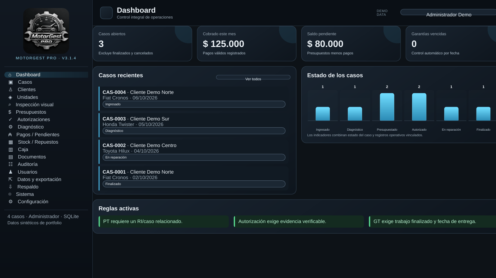
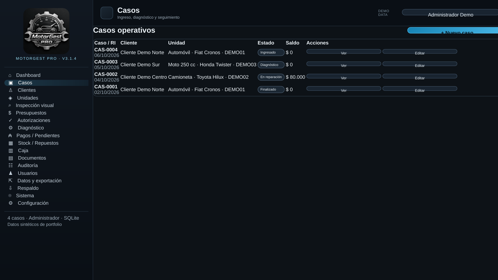
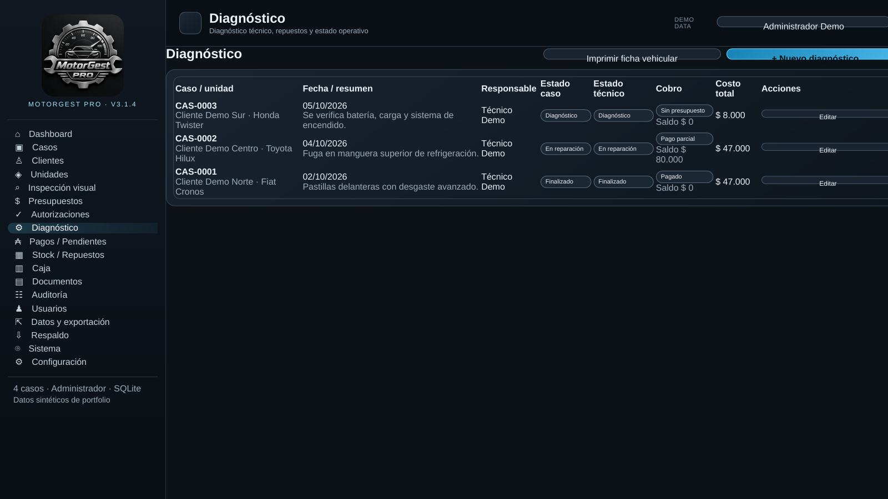
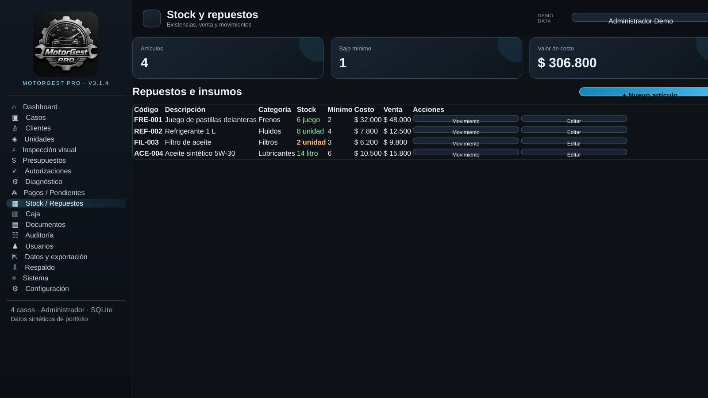
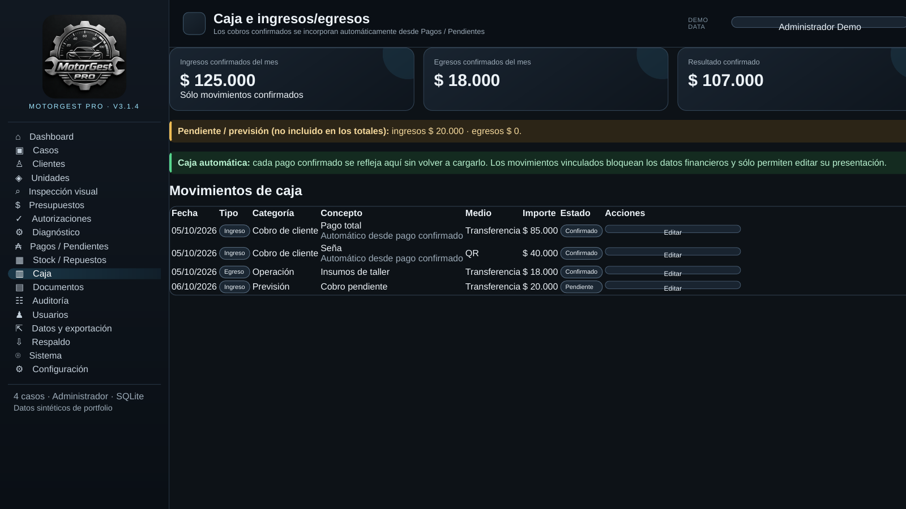
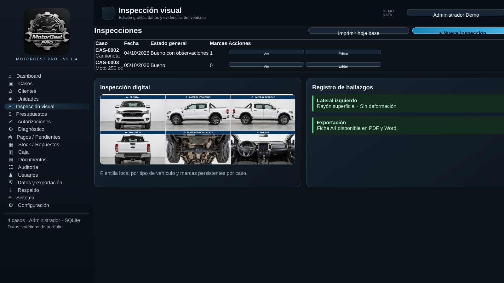

# MotorGest Pro — Portfolio Edition

**MotorGest Pro** is a Windows-oriented desktop workshop-management system built to demonstrate applied software engineering across desktop UI, persistence, business rules, security, privacy, reporting and automated testing.

Current product release represented here: **3.1.4** · SQLite schema: **4**.

> **This is the public Portfolio Edition.** It intentionally contains selected real source modules, selected regression tests, architecture documentation and synthetic-data screenshots — **not the complete runnable product**. The complete Full Source repository is maintained privately and can be shared deliberately for deeper technical review during a recruitment process.

## What this repository demonstrates

- Python application architecture and SQLite persistence.
- JavaScript domain rules for inventory and cash integrity.
- Data sanitization and pseudonymization for external analysis.
- PDF and DOCX document generation.
- Regression tests around stock, payments/cash, backups and privacy.
- Desktop architecture based on PySide6 + Qt WebEngine/WebChannel.
- Role-based workflows, local backups and Windows-oriented security design.
- Product documentation, versioning and release hygiene.

## Product overview

The private Full Source application supports a workshop workflow similar to:

`Cliente → Unidad → Caso → Diagnóstico → Presupuesto → Autorización → Reparación → Pago → Finalización → Garantía`

It includes client/unit management, diagnostics, inventory, payments, cash synchronization, visual vehicle inspections, operational documents, user roles, email verification, backups and local SQLite persistence.

## Screenshots

All screenshots use **synthetic demo-only data**. They contain no real customer, vehicle or financial information.

| Dashboard | Cases |
| --- | --- |
|  |  |

| Diagnostics | Inventory |
| --- | --- |
|  |  |

| Cash management | Visual inspection |
| --- | --- |
|  |  |

The captures are documentation renders built from the actual MotorGest Pro HTML/CSS, logos, component structure and vehicle assets using synthetic data. See `docs/screenshots/README.md`.

## Selected source code

This public edition exposes representative implementation areas rather than the entire application:

```text
src/motorgest/
├── constants.py          # release/schema constants
├── database.py           # SQLite snapshot persistence + validation/backup
├── privacy.py            # anonymization/pseudonymization boundary
└── inspection_export.py  # PDF/DOCX inspection documents

web/assets/
└── integrity.js          # pure stock/cash domain integrity rules

tests/
├── test_stock_case_delete_integrity.py
├── test_cash_payment_integrity.py
├── test_analysis_export_privacy.py
├── test_backup_restore_integrity.py
└── test_document_exports.py
```

See `CODE_SAMPLES.md` for what each sample is intended to demonstrate.

## Architecture

The complete application uses:

```text
PySide6 desktop shell
        ↓
Qt WebEngine
        ↓
HTML / CSS / JavaScript UI
        ↕ Qt WebChannel
Python desktop services
        ↓
SQLite / backups / exports / SMTP / local files
```

The full product does **not** require an internal HTTP server. Operational data is local-first and the database is created outside the repository under the Windows Documents area.

A more detailed public architecture description is available in `ARCHITECTURE.md`.

## Tech stack

- Python 3.10–3.14
- PySide6 / Qt WebEngine / Qt WebChannel
- HTML5 / CSS / JavaScript
- SQLite
- ReportLab
- python-docx
- Pillow
- jsPDF / jsPDF-AutoTable in the private application
- PyInstaller for Windows packaging

## Integrity and privacy examples

The selected code demonstrates several non-trivial rules used by the product:

- deleting a case can reconcile stock with a compensating movement instead of silently losing inventory history;
- cash movements derived from confirmed payments maintain traceability and avoid orphan payment references;
- confirmed and pending cash totals are separated;
- external-analysis data is pseudonymized and direct PII/credentials are removed at the Python boundary;
- SQLite backups can be integrity-checked and restored without including a production database in source control.

## Running the selected tests

The public edition is **not a standalone MotorGest Pro application**, but the selected source samples have their own regression tests.

Python dependencies for these samples:

```text
python -m venv .venv
.venv\Scripts\activate
python -m pip install -r requirements-portfolio.txt
pytest -q
```

The two JavaScript integrity tests also require Node.js to be available on `PATH`. The prepared Portfolio Edition passes **7/7 selected tests** in the release validation environment.

## Why the complete source is private

MotorGest Pro is both a portfolio project and a possible future commercial product. A public repository should demonstrate engineering quality without distributing the entire operational implementation.

The private **Full Source edition** contains the complete frontend, Python backend, runtime assets, all tests and Windows tooling. Access can be granted intentionally for a technical interview or code review when appropriate.

See `PORTFOLIO_SCOPE.md` for the exact public/private boundary.

## Security and data handling

No production database, backup, log, SMTP secret, user credential or real customer/vehicle data is included in this repository.

The full application uses, among other controls:

- PBKDF2-SHA-256 password hashing with per-user salt;
- login attempt lockout;
- role/action restrictions;
- email OTP verification with expiration and rate limiting;
- Windows DPAPI for the local SMTP password;
- local SQLite persistence and explicit backup paths;
- backend-enforced sanitization for external-analysis packages.

The current desktop trust model and future hardening boundaries are documented in `ARCHITECTURE.md`.

## Project status

**Active portfolio / product development.** Version 3.1.4 is a maintenance and presentation release focused on source-review quality, repository separation and a corrected single cash-rendering path while preserving the integrity/privacy work introduced in V3.1.3.

## Author

**Carlos Adrián Ledesma**  
GitHub: **@carlos-adrian-ledesma**

## License

Copyright © 2026 Carlos Adrián Ledesma. All rights reserved.

The original MotorGest Pro code published here is proprietary and provided for portfolio/evaluation purposes only. It is **not** released under an open-source license. Third-party software remains governed by its own licenses. See `LICENSE` and `THIRD_PARTY_NOTICES.md`.
